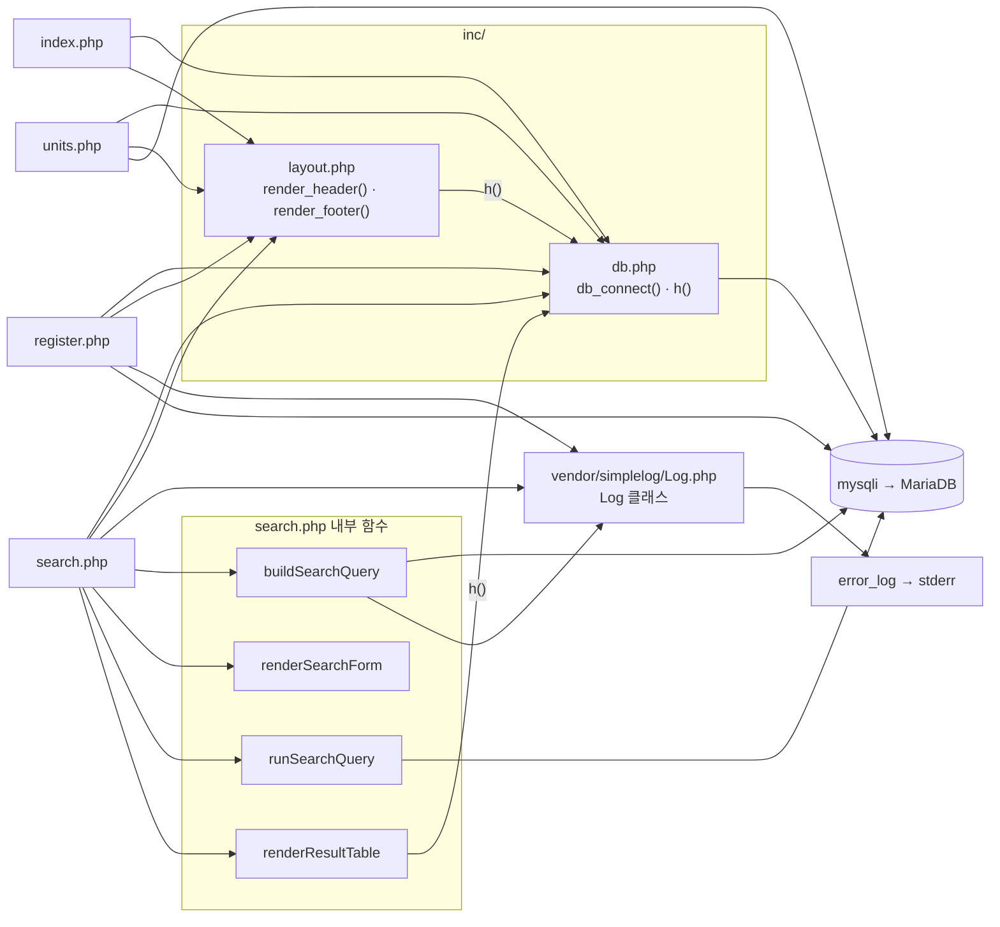

# 문항 은행(레거시 PHP) 아키텍처

대상: `legacy/item-bank-php/` · 범위: 진입점 · 의존 관계 분석 (데이터 흐름 · 비즈니스 규칙은 아직 분석하지 않음)

## 1. 모듈 개요

- PHP 7.4 + Apache 이미지(`Dockerfile:1`)에 소스를 문서 루트로 복사해 실행한다(`Dockerfile:14`). 호스트 포트 8081 → 컨테이너 80(`docker-compose.yml:39`).
- 라우터 · 프론트 컨트롤러가 없고 PHP 파일 1개 = 화면 1개다(홈 · 단원 목록 · 문항 등록 · 문항 검색).
- DB 는 mysqli 로 MariaDB 에 접속하며 연결을 `static` 으로 캐시한다(`inc/db.php:9-12`, `inc/db.php:21`).
- 로그는 외부 라이브러리 `SimpleLog\Log` 가 `error_log` 로만 남기고(`vendor/simplelog/Log.php:52`) 컨테이너 stderr 로 간다(`Dockerfile:11`).
- `vendor/` 를 뺀 PHP 파일 6개 1,050줄 중 `search.php` 가 731줄이다.

## 2. 폴더 구조

```
legacy/item-bank-php/
├── Dockerfile               (16줄)  php:7.4-apache, mysqli, rewrite 모듈
├── index.php                (14줄)  홈 · 메뉴
├── units.php                (48줄)  단원 목록
├── register.php            (177줄)  문항 등록 (GET 폼 / POST 저장)
├── search.php              (731줄)  문항 검색
├── inc/
│   ├── db.php               (37줄)  db_connect(), h()
│   └── layout.php           (43줄)  render_header(), render_footer()
└── vendor/simplelog/
    └── Log.php              (54줄)  외부 라이브러리(더미) — 시그니처만 확인
```

- `.htaccess` 는 없다(`ls -la` 결과).

## 3. 진입점 표

| URL / 화면 | 처음 실행되는 파일 | 주요 호출 (근거) |
|---|---|---|
| `:8081/index.php` 홈(메뉴) | `index.php` | `render_header('홈')` `index.php:5`, `render_footer()` `index.php:14`. 메뉴 링크 3개 `index.php:9-11` |
| `:8081/units.php` 단원 목록 (GET) | `units.php` | `render_header` `units.php:5`, `db_connect` `units.php:8`, `$conn->query` `units.php:20`, `h` `units.php:40-43`, `render_footer` `units.php:48` |
| `:8081/register.php` 문항 등록 (GET 폼 / POST 저장) | `register.php` | `db_connect` `register.php:17`, 단원 · 태그 목록 `$conn->query` `register.php:27,34`, POST 분기 `register.php:40`, `begin_transaction`/`prepare`/`commit`/`rollback` `register.php:85,92,105,114,120`, `Log::info` `register.php:115`, `Log::error` `register.php:121`, `render_header` `register.php:127`, `render_footer` `register.php:177` |
| `:8081/search.php` 문항 검색 (GET) | `search.php` | `render_header` `search.php:709`, `db_connect` `search.php:713`, `buildSearchQuery($_GET, $conn)` `search.php:722`, `renderSearchForm` `search.php:723`, `runSearchQuery` `search.php:724`, `renderResultTable` `search.php:725`, `Log::error` `search.php:727`, `render_footer` `search.php:731` |
| `:8081/` (루트) | 미확인 | `DirectoryIndex` 설정 · rewrite 규칙을 저장소에서 찾지 못함. `a2enmod rewrite` 만 켜져 있음(`Dockerfile:4`) |

- 공통 메뉴 정의: `inc/layout.php:9-13` (search · register · units).
- `search.php` GET 파라미터 `q`, `unit`, `level`, `tag`, `sort`, `dir`, `page` — 주석 기준(`search.php:5-12`). 코드와 일치하는지는 미확인.

## 4. 의존 관계

### 4.1 흐름도

화살표 방향: A → B = A 가 B 를 포함하거나 호출한다.



### 4.2 호출 표

**파일 포함 (`require_once`)**

| A | → B | 근거 |
|---|---|---|
| `index.php` | `inc/db.php`, `inc/layout.php` | `index.php:2`, `index.php:3` |
| `units.php` | `inc/db.php`, `inc/layout.php` | `units.php:2`, `units.php:3` |
| `register.php` | `inc/db.php`, `inc/layout.php`, `vendor/simplelog/Log.php` | `register.php:2`, `register.php:3`, `register.php:4` |
| `search.php` | `inc/db.php`, `inc/layout.php`, `vendor/simplelog/Log.php` | `search.php:20`, `search.php:21`, `search.php:22` |

- `inc/*` 와 `Log.php` 는 다른 파일을 포함하지 않는다(파일 전체 확인). 화면 파일끼리도 서로 포함하지 않는다.

**함수 호출**

| A | → B | 근거 | 비고 |
|---|---|---|---|
| `inc/layout.php` `render_header` | `inc/db.php` `h()` | `inc/layout.php:17,33` | `layout.php` 는 `db.php` 를 포함하지 않는다. 네 화면 모두 `db.php` 를 먼저 포함해 동작한다 |
| `inc/db.php` `db_connect` | `mysqli` 생성 | `inc/db.php:21` | `static` 캐시 `inc/db.php:9-12`, 접속 정보는 환경 변수 → 없으면 기본값 `inc/db.php:14-18` |
| `search.php` 실행 블록 | `buildSearchQuery` → `renderSearchForm` → `runSearchQuery` → `renderResultTable` | `search.php:722-725` | |
| `buildSearchQuery` | `Log::debug` | `search.php:103,528` | grep 기준 |
| `buildSearchQuery` | `Log::error` | `search.php:537` | grep 기준 |
| `buildSearchQuery` | `$conn->prepare` (단원 코드 조회) | `search.php:125` | grep 기준 |
| `buildSearchQuery` | `$conn->query` (단원 목록 · 태그 목록) | `search.php:156`, `search.php:178` | grep 기준 |
| `buildSearchQuery` | `h()` | 19회 (grep 기준) | |
| `runSearchQuery` | `$conn->prepare` / `bind_param` / `execute` | `search.php:577-621` | 건수 쿼리 → 페이지 쿼리 2회 |
| `renderSearchForm` | `$built['form_html']` 출력 | `search.php:631-637` | HTML 은 `buildSearchQuery` 가 만든다 |
| `renderResultTable` | `h()` | `search.php:674-678,690,696,700` | `warning_html` · `summary_html` · `sort_links` 는 이스케이프 없이 출력 `search.php:652-653,665-669` |
| `register.php`, `search.php` | `SimpleLog\Log` | `register.php:6`, `search.php:24` | |
| `SimpleLog\Log::write` | `error_log` | `vendor/simplelog/Log.php:52` | 출력은 컨테이너 stderr `Dockerfile:11` |

## 5. 가장 긴 함수 3개

| 순위 | 파일 | 함수 | 시작~끝 | 길이 | 하는 일 |
|---|---|---|---|---|---|
| 1 | `search.php` | `buildSearchQuery` | 42~564 | 523줄 | GET 파라미터로 SQL · 건수 SQL · 바인딩 · 폼/요약/정렬 링크 HTML · 경고 · 페이지 상태를 한 배열로 조립한다(docblock `search.php:29-41`, 본문 로직 미확인) |
| 2 | `search.php` | `renderResultTable` | 647~704 | 58줄 | 건수 문구 · 결과 표 · 페이지 이동 링크를 출력한다. 0건이면 `검색 결과가 없습니다` 를 내고 끝낸다(`search.php:657-660`) |
| 3 | `search.php` | `runSearchQuery` | 571~624 | 54줄 | prepared statement 로 건수 쿼리와 현재 페이지 쿼리를 실행해 `total` · `rows` 를 돌려준다(`search.php:623`) |

- 선언된 함수는 `search.php` 4개, `inc/` 4개, `Log` 클래스 메서드뿐이다. `register.php` · `units.php` 는 함수 없는 위→아래 스크립트라 순위에서 빠진다. `register.php` 의 저장 흐름(`register.php:40-125`, 약 85줄)은 함수가 아니다.

## 6. 미확인 목록

| 항목 | 이유 · 다음 단계 |
|---|---|
| `buildSearchQuery` 본문(`search.php:61-559`) | 호출하는 줄만 grep 으로 확인. SQL 조립 방식 · 정렬/페이징 규칙 · `*_html` 값의 이스케이프 여부는 데이터 흐름 단계에서 조건 블록별로 읽는다 |
| `search.php` GET 파라미터가 주석(`search.php:5-12`)과 일치하는지 | 위 본문을 읽어야 확인된다 |
| `warning_html` · `summary_html` · `sort_links` 의 안전성 | 이스케이프 없이 출력(`search.php:652-653,665-669`)되므로 생성 쪽(`buildSearchQuery`) 확인 필요 |
| 루트 URL `/` 의 동작 | 저장소 안에 `DirectoryIndex` · rewrite 규칙이 없어 Apache 이미지 기본 설정에 달려 있음 |
