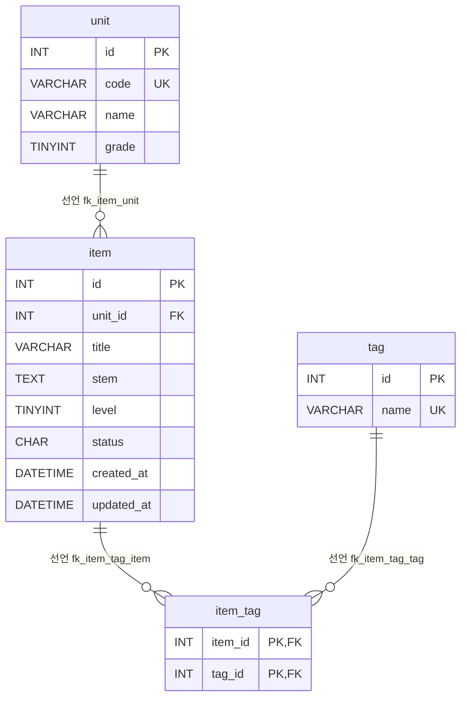

# 문항 은행(레거시 PHP) 데이터 흐름 · ERD

대상: `legacy/item-bank-php/` · 스키마: `db/mariadb/init/01-schema.sql` (DB `itembank`)
진입점 · 의존 관계는 [ARCHITECTURE.md](ARCHITECTURE.md) 참고.

## 1. 테이블 목록

이 모듈의 PHP 코드가 참조하는 테이블 4개와 뷰 1개다.

| 테이블 | 주요 컬럼 | 키 · 제약 | 근거 |
|---|---|---|---|
| `unit` | `id` INT, `code` VARCHAR(16), `name` VARCHAR(100), `grade` TINYINT | PK `id`, UNIQUE `code` (`uk_unit_code`) | `db/mariadb/init/01-schema.sql:11-18` |
| `item` | `id` INT, `unit_id` INT, `title` VARCHAR(200), `stem` TEXT, `level` TINYINT(주석 "1~5"), `status` CHAR(1) 기본 `'A'`(주석 "A=공개 D=삭제 R=검수중"), `created_at` · `updated_at` DATETIME | PK `id`(AUTO_INCREMENT 아님), 인덱스 `unit_id` · `level`, FK `unit_id` → `unit.id` | `db/mariadb/init/01-schema.sql:20-33` |
| `tag` | `id` INT, `name` VARCHAR(50) | PK `id`, UNIQUE `name` (`uk_tag_name`) | `db/mariadb/init/01-schema.sql:35-40` |
| `item_tag` | `item_id` INT, `tag_id` INT | PK (`item_id`, `tag_id`), FK `item_id` → `item.id`, FK `tag_id` → `tag.id` | `db/mariadb/init/01-schema.sql:42-48` |

**뷰 `v_item_public`** (`db/mariadb/init/01-schema.sql:52-70`)

- 컬럼: `id`, `unit_id`, `unit_code`, `unit_name`, `unit_grade`, `title`, `stem`, `level`, `created_at`, `updated_at`, `tag_names`
- `item` 과 `unit` 을 `u.id = i.unit_id` 로 JOIN 한다(`:69`). `tag_names` 는 `item_tag` 와 `tag` 를 JOIN 한 뒤 `GROUP_CONCAT(t.name ORDER BY t.id SEPARATOR ',')` 로 만든다(`:64-67`).
- 조건은 `WHERE i.status = 'A'` 이다(`:70`). 단, BUSINESS-RULES.md 교차 검증(BR-01, CX-07 판정)에서는 이 제외 조건을 이 모듈 코드로 검증하지 않은 것으로 두었다.

**참조하지 않는 테이블:** 같은 스키마 파일에 `class` · `assignment` · `distribution` · `submission`(`db/mariadb/init/01-schema.sql:75-115`)이 있다. 주석상 assignment-thymeleaf 모듈용이고(`:73`), 이 모듈의 PHP 파일에는 참조가 없다(grep 확인). 이 문서의 범위 밖이다.

## 2. 테이블 관계

| 관계 | 구분 | 스키마 근거 | 코드에서 같은 관계로 JOIN · 참조하는 곳 |
|---|---|---|---|
| `item.unit_id` → `unit.id` (N:1) | 선언 | `db/mariadb/init/01-schema.sql:32` | 뷰 JOIN `01-schema.sql:69`, `units.php:17` 상관 서브쿼리, `register.php:61-65` 단원 목록으로 id 확인 |
| `item_tag.item_id` → `item.id` (N:1) | 선언 | `db/mariadb/init/01-schema.sql:46` | 뷰 `01-schema.sql:67`, `search.php:244-245` (`it.item_id = v_item_public.id`), `register.php:105` INSERT |
| `item_tag.tag_id` → `tag.id` (N:1) | 선언 | `db/mariadb/init/01-schema.sql:47` | 뷰 `01-schema.sql:66`, `search.php:244` (`JOIN tag t ON t.id = it.tag_id`), `register.php:75-81` 태그 목록으로 id 확인 |

- 카디널리티 근거: `item.unit_id` 가 `NOT NULL` 이므로(`01-schema.sql:22`) 문항 1개는 단원 1개에 속한다. `item` ↔ `tag` 는 `item_tag` 를 거친 N:M 관계다.
- **추정 관계는 없다.** 코드의 JOIN 과 서브쿼리가 쓰는 관계 3개는 모두 FK 로 선언돼 있다.
- 검색의 단원 조건은 `unit.id` 가 아니라 뷰의 `unit_code`(= `unit.code`)와 비교한다(`search.php:118`). 관계가 새로 생기는 것은 아니다.

## 3. 읽기 · 쓰기 위치

`register.php` 와 `units.php` 는 함수 없는 스크립트라 "스크립트 본문"으로 적는다.

| 테이블 / 뷰 | 읽기 (SELECT) | 쓰기 (INSERT · UPDATE · DELETE) |
|---|---|---|
| `unit` | `units.php` 스크립트 본문 — 단원 목록과 단원별 공개 문항 수 `units.php:16-19` `register.php` 스크립트 본문 — 단원 선택 목록 `register.php:27` `search.php` `buildSearchQuery` — 코드로 단원명 · 학년 조회 `search.php:125`, 단원 선택 목록 `search.php:156` (간접) `v_item_public` 을 통해 읽음 | 없음 |
| `item` | `units.php` 스크립트 본문 — `status = 'A'` 건수 `units.php:17` `register.php` 스크립트 본문 — 다음 id 채번 `SELECT COALESCE(MAX(id), 0) + 1 … FOR UPDATE` `register.php:87` (간접) `v_item_public` 을 통해 읽음 | **INSERT** `register.php` 스크립트 본문 `register.php:92-101`. `status` 는 `'R'` 고정, `created_at` · `updated_at` 은 `NOW()` (`register.php:94`) UPDATE · DELETE 없음 |
| `tag` | `register.php` 스크립트 본문 — 태그 선택 목록 `register.php:34` `search.php` `buildSearchQuery` — 태그 선택 목록 `search.php:178`, 태그 조건 EXISTS 서브쿼리 조립 `search.php:244-245`(실행은 `runSearchQuery`) (간접) `v_item_public.tag_names` | 없음 |
| `item_tag` | `search.php` `buildSearchQuery` — 태그 조건 EXISTS 서브쿼리 조립 `search.php:244-245`(실행은 `runSearchQuery`) (간접) `v_item_public.tag_names` | **INSERT** `register.php` 스크립트 본문 `register.php:104-113` (item INSERT 와 같은 트랜잭션 `register.php:85,114`) UPDATE · DELETE 없음 |
| `v_item_public` (뷰) | `search.php` `buildSearchQuery` 가 SQL 을 조립하고(`search.php:521-526`) `runSearchQuery` 가 건수 · 페이지 쿼리로 실행한다(`search.php:577`, `search.php:600`) | 해당 없음 |

- 이 모듈에는 `UPDATE` · `DELETE` 문이 없다(grep 확인). `FOR UPDATE` 잠금 절만 있다(`register.php:87`).
- 따라서 `item.status` 를 `R` → `A` 로 바꾸는 코드(검수 완료)는 이 모듈에 없다.

### 데이터 흐름 요약

- **등록:** `register.php` POST → 검증(`register.php:47-81`) → 트랜잭션에서 `item` INSERT(`status='R'`), 이어서 `item_tag` INSERT → commit(`register.php:85-114`)
- **검색:** `search.php` GET → `buildSearchQuery`(조건 · 정렬 · 페이지로 `v_item_public` SQL 조립, 한 페이지 20건 `search.php:349,523`) → `runSearchQuery` 실행 → `renderResultTable` 출력
- **단원 목록:** `units.php` GET → `unit` 전체와 `item` 의 `status='A'` 건수(`units.php:16-19`) → 표 출력

## 4. 미확인 목록

| 항목 | 이유 |
|---|---|
| `item.status` 를 `R` → `A`(검수 완료)나 `D`(삭제)로 바꾸는 주체 | 이 모듈에 UPDATE 가 없다. 다른 모듈 · 수작업 · 배치 중 어디인지 확인하지 않았다 |
| 스키마 주석 "등록 화면도 이 뷰를 기준으로 삼는다"(`01-schema.sql:51`)의 뜻 | `register.php` 에는 `v_item_public` 참조가 없다(grep 확인). 주석과 코드가 다르다 |
| `item.level` 1~5 제약 | 스키마는 주석뿐이고(`01-schema.sql:25`) CHECK 제약이 없다. 등록 화면 검증은 `register.php:70` 에 있다. 다른 경로로 들어온 값이 있는지는 확인하지 않았다 |
| `item.status` 값의 범위(A · D · R 외) | 주석뿐이고(`01-schema.sql:26`) 제약이 없다 |
| 운영 DB 스키마와 이 파일의 일치 여부 | 실습용 init 스크립트만 봤다 |
| 시드 데이터(`db/mariadb/init/02-seed.sql`)의 내용 | 섹션 머리 주석만 봤고, 행 단위로는 검증하지 않았다 |
